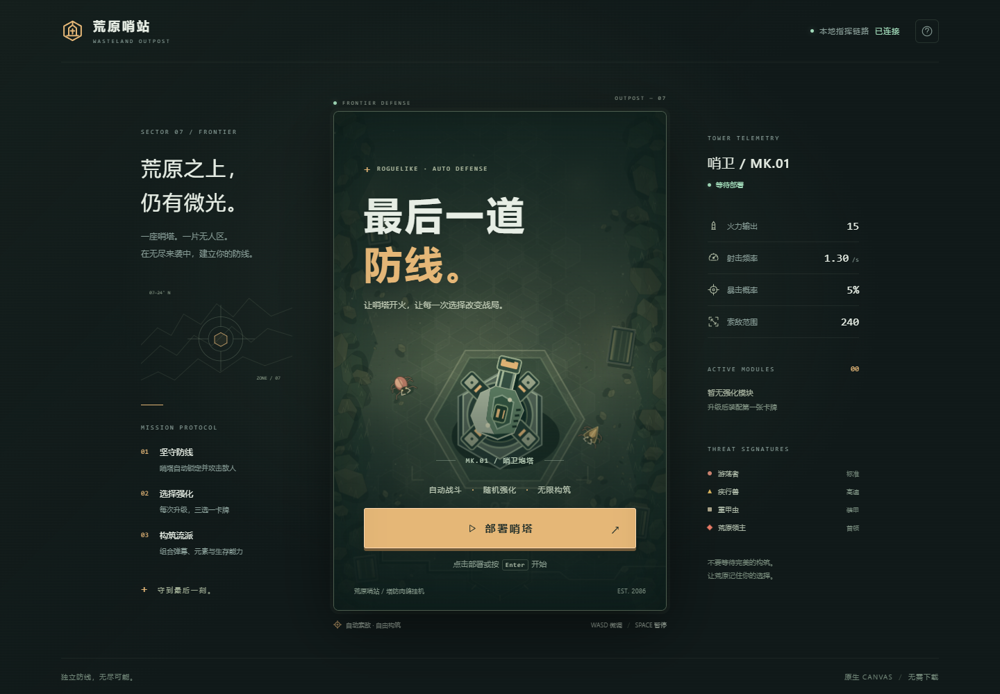
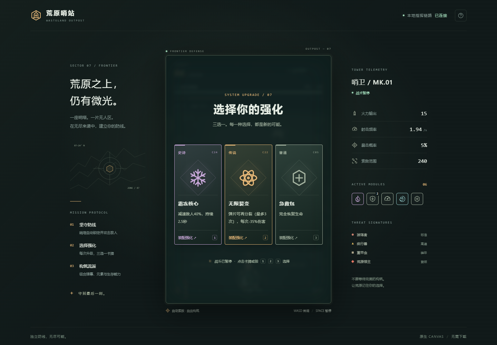

# 荒原哨站 · 塔防肉鸽挂机 (Tower Defense Roguelike AFK)
[](https://CNSleepybear.github.io/tower-defense-roguelike-afk/)
[](https://developer.mozilla.org/zh-CN/docs/Web/API/Canvas_API)
[](LICENSE)

一个基于 HTML5 Canvas 开发的轻量级塔防 + 肉鸽 (Roguelike) 挂机小游戏，纯前端实现无后端依赖，融合自动战斗、随机卡牌养成、动态视觉特效，开箱即玩。




## 美术升级：荒原哨站

- **完整主题**：苔绿荒原、沙金指令与工业哨塔，重新设计主菜单、战场 HUD、强化、暂停与结算。
- **原创场景与单位**：岩石、荒草、货箱、六边形路面；机械炮塔和四类具有独立轮廓的虫群敌人。
- **统一图标与特效**：28 张卡牌采用一致的 SVG 图标体系，元素炮口、弹道、冲击环和碎片反馈统一配色。
- **手机与键盘体验**：窄屏卡牌竖排，支持触摸、可见焦点、数字键选牌、暂停及操作手册。
- **纯本地美术**：Canvas / SVG 原创绘制，无外部美术素材、远程字体或第三方运行库依赖。

参考方向与实现细节见 [美术说明](docs/ART_DIRECTION.md)。原版 `screenshot.png` 和 `demo.gif` 保留作为历史预览。

---

## ✨ 功能特性
### �炮塔战斗系统
- **全自动挂机攻击**：炮塔智能锁定范围内最近敌人，无需手动操作
- **多维敌人体系**：4 类敌人（普通/快速/坦克/BOSS），属性随波次动态成长
- **物理碰撞检测**：子弹轨迹、穿透/分裂/连锁攻击的真实物理反馈
- **避障与优先级**：炮塔优先攻击高威胁目标（BOSS/坦克），自动规避地形遮挡

### 🃏 肉鸽养成核心
- **随机卡牌池**：4 个稀有度（普通/稀有/史诗/传说），30+ 差异化强化卡牌
- **元素体系联动**：火（灼烧）、冰（减速）、雷（连锁）、毒（持续+爆炸）四维元素
- **炮塔成长树**：攻击力/攻速/暴击/血量/范围等多维属性叠加，无成长上限
- **局内永久强化**：每级随机 3 选 1 卡牌，不同组合触发差异化流派（暴击流/元素流/生存流）

### 🎨 视觉与交互
- **粒子特效系统**：击中火花、死亡爆炸、升级光效、元素附着等 10+ 特效类型
- **动态 UI 反馈**：伤害飘字、暴击动画、屏幕震动、Debuff 图标实时显示
- **响应式适配**：自动适配桌面端/移动端，支持触摸/鼠标双操作模式
- **沉浸式音效**：攻击音效、升级提示音、BOSS 出场音效（可选开启）

### ⚡ 性能优化
- **对象池复用**：子弹/粒子/敌人对象池化，减少内存频繁分配
- **帧率自适应**：FPS 低于 30 时自动关闭非核心特效，保证流畅挂机
- **视口裁剪**：仅渲染屏幕内可见对象，降低 Canvas 绘制压力
- **批量渲染**：敌人/子弹批量绘制，减少 Canvas 绘制调用次数

---

## 🚀 在线体验
**🔗 [立即体验塔防肉鸽挂机](https://CNSleepybear.github.io/tower-defense-roguelike-afk/)**

### 🕹️ 操作指南
| 操作 | 功能 |
| :---- | :---- |
| 🖱️/👆 点击部署 / 卡牌 / 再次部署 | 开始游戏/选择卡牌/重启游戏 |
| ⌨️ Enter | 在标题界面开始游戏 |
| ⌨️ 空格键 | 暂停/继续挂机战斗 |
| ⌨️ WASD / 方向键 | 微调炮塔位置 |
| ⌨️ 1 / 2 / 3 | 选择对应强化卡牌 |
| ⌨️ Esc | 关闭手册或暂停/继续战斗 |
| ❔ 右上角问号 | 查看操作手册（打开时暂停战斗） |
| 📊 战场顶部 / 桌面右侧 | 查看波次、装甲、经验与炮塔属性 |

---

## 🛠️ 技术栈
- **HTML5 Canvas 2D**：原生 2D 渲染引擎，无第三方游戏库依赖
- **JavaScript (ES6+)**：面向对象架构，模块化管理游戏逻辑
- **CSS3 Flex/Grid**：响应式布局，适配多设备屏幕
- **对象池模式**：优化高频创建/销毁的游戏对象（子弹/粒子）
- **性能监控**：实时统计 FPS、绘制调用、对象数量

---

## 📦 本地运行
### 📋 环境要求
- 现代浏览器（Chrome / Edge 111+、Firefox 113+、Safari 16.4+，需要 Canvas `roundRect` 与 CSS 容器查询）
- 支持 Canvas 2D 的设备（几乎所有现代设备）
- 本地服务器（可选，避免跨域/本地资源加载问题）

### ⚡ 快速开始
```bash
# 1. 克隆仓库
git clone https://github.com/CNSleepybear/tower-defense-roguelike-afk.git
cd tower-defense-roguelike-afk

# 2. 启动本地服务器（任选其一）
# Python 3 内置服务器
python -m http.server 8000

# Node.js (需先安装http-server)
npx http-server -p 8000

# VS Code 快捷方式（安装Live Server插件）
# 右键 index.html → Open with Live Server

# 3. 浏览器访问
open http://localhost:8000
```

---

## 📁 项目结构
```
tower-defense-roguelike-afk/
├── index.html       # 页面结构、战斗逻辑、卡牌数据库
├── art.js           # Canvas 美术、场景缓存、SVG 图标
├── ui.js            # HUD、卡牌界面、暂停与键盘操作
├── styles.css       # 主题、响应式布局与交互样式
├── README.md        # 项目说明文档
├── LICENSE          # 开源许可证
├── screenshot.png   # 原版静态预览
├── demo.gif         # 原版动态预览
└── docs/
    ├── ART_DIRECTION.md # 美术规范与参考边界
    └── previews/    # 新版桌面与手机预览
```

---

## 🎮 系统配置要求
| 画质等级 | FPS 目标 | 同时渲染对象 | 开启特性 | 推荐设备 |
| :---: | :---: | :---: | :---- | :---- |
| 🟢 极高 | 60+ | 100+ 敌人/子弹 | 全部特效（粒子+震动+动态UI） | 中高端PC/旗舰手机 |
| 🔵 高 | 60 | 80+ 敌人/子弹 | 核心特效（粒子+伤害飘字） | 主流PC/中端手机 |
| 🟡 中 | 45 | 50+ 敌人/子弹 | 基础特效（仅伤害飘字） | 入门PC/入门手机 |
| 🔴 低 | 30 | 30+ 敌人/子弹 | 无特效（仅基础渲染） | 低配老旧设备 |

> ⚠️ 游戏启动时会自动检测设备性能并匹配最优画质等级，也可在右上角面板手动调整。

---

## 🖥️ 性能监控
界面右上角实时展示游戏运行状态，包含以下核心指标：
- **FPS**：当前渲染帧率（目标 60 FPS）
- **帧时间**：单帧渲染耗时（ms），<16ms 为流畅
- **当前波次**：已抵御的敌人波数，BOSS 波次会标红提示
- **炮塔属性**：攻击力/攻速/暴击率/元素触发率实时显示
- **绘制调用**：Canvas 每帧绘制次数，越低性能越好
- **内存占用**：游戏运行内存使用量（MB）

---

## 🧠 核心机制亮点
### 肉鸽卡牌随机算法
卡牌选择阶段采用「权重随机 + 流派引导」逻辑，保证随机性的同时避免无效养成：
- **稀有度权重**：普通(60%) > 稀有(25%) > 史诗(10%) > 传说(5%)
- **流派引导**：若已选 2 张火系卡牌，下轮优先刷出火系联动卡牌
- **保底机制**：每 10 级必出至少 1 张史诗/传说卡牌

### 敌人波次生成逻辑
```javascript
// 核心波次生成规则（伪代码）
function generateWave(waveNum) {
  const baseCount = 5 + waveNum * 1.2; // 基础敌人数量随波次增长
  const enemyTypes = ['normal', 'fast', 'tank'];
  // BOSS波（每10波）：概率生成BOSS，且坦克敌人占比提升
  if (waveNum % 10 === 0) {
    enemyTypes.push('boss');
    return mixEnemies(baseCount * 2, enemyTypes, { tank: 0.4, boss: 0.1 });
  }
  return mixEnemies(baseCount, enemyTypes, { normal: 0.6, fast: 0.2, tank: 0.2 });
}
```

---

## 📝 自定义配置
可在代码中搜索关键字 `GAME_CONFIG`，修改核心游戏参数实现个性化定制：
```javascript
// 游戏核心配置参数
const GAME_CONFIG = {
    initialFishCount: 80,        // 初始炮塔攻击力 (推荐：5-20)
    seaweedCount: 150,           // 初始敌人波数间隔 (推荐：1-5秒)
    coralCount: 40,              // 卡牌稀有度权重调整
    fogDensity: 0.012,           // 粒子特效数量上限 (推荐：50-200)
    bloomStrength: 0.35,         // BOSS出现间隔 (推荐：5-15波)
    sunIntensity: 4,             // 炮塔攻击范围 (推荐：100-300px)
    timeScale: 1                 // 游戏时间流速 (0.5-2，1为正常速度)
};
```

---

## 🤝 贡献指南
欢迎提交 **Issue** 反馈问题/提需求，或提交 **Pull Request** 参与开发！推荐贡献方向：
- 添加更多卡牌类型和流派（如防御塔、辅助技能、全局 BUFF）
- 实现存档/读档功能（基于 localStorage）
- 增加更多敌人类型和 BOSS 专属技能
- 优化移动端触摸体验和适配细节
- 加入成就系统和排行榜功能
- 扩展背景音乐和音效体系

---

## 📄 许可证
本项目采用 **MIT 开源许可证** - 查看 [LICENSE](LICENSE) 文件获取详细信息 © Ranzhouhua

---

## 🙏 致谢
- **HTML5 Canvas 文档**：提供原生 2D 渲染的核心 API 参考
- **Roguelike 游戏设计指南**：肉鸽随机养成机制的设计参考
- **塔防游戏经典案例**：炮塔 AI、敌人路径规划的实现思路
- **前端性能优化社区**：Canvas 批量渲染、对象池的优化方案

---

🌟 如果这个项目对你有帮助，欢迎点个 **Star** 支持一下！你的支持是持续开发的动力～
